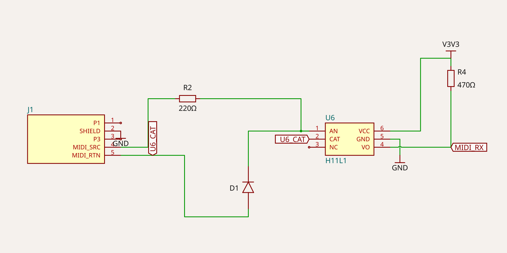
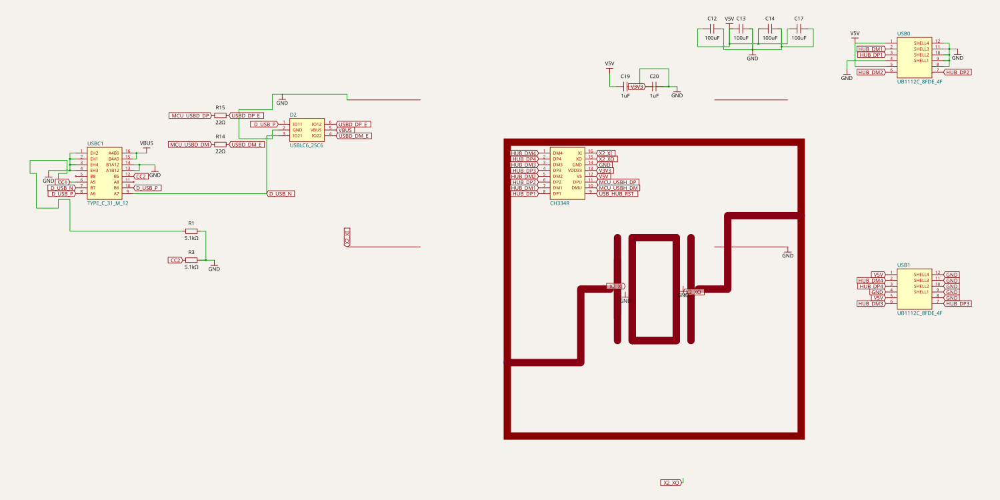
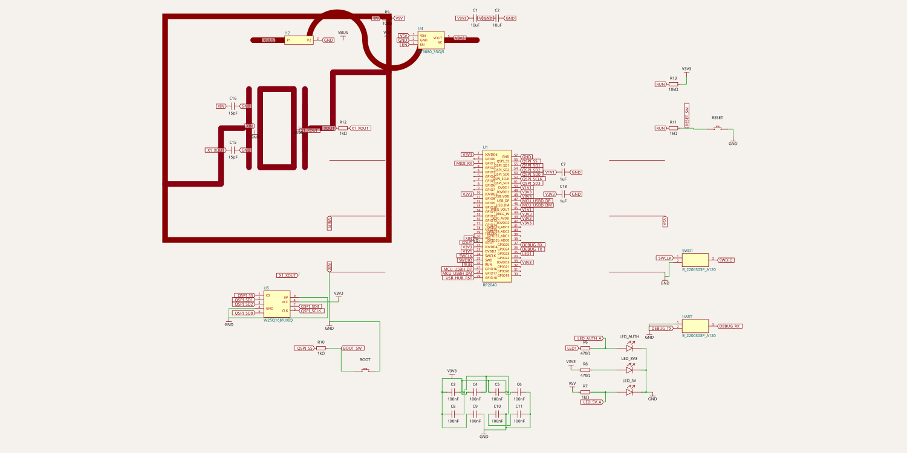

# OpenRB — schematic-as-code (tscircuit)

The whole OpenRB rev 0.2 board described as **code** ([tscircuit](https://tscircuit.com))
instead of a GUI schematic: the source is diff-able and regenerable, it renders real
schematics, and it exports native **KiCad** `.kicad_sch` files that KiCad re-opens.

Why: the editable EasyEDA source was lost, and the [`../kicad/`](../kicad) reconstruction is
a netlist connected purely by labels (no drawn wires). This is a code source of truth built
from the verified netlist in [`../RECONSTRUCTION.md`](../RECONSTRUCTION.md), with the **exact
LCSC parts** pulled by part number (`tsci import`).

## The board — three sheets

A hierarchical design, mirroring the original: three sheets joined by shared **net-label
names** (e.g. `MCU_USBD_DP`, `MCU_USBH_DP`, `USB_HUB_RST`, `MIDI_RX`, `V3V3`, `V5V`, `VBUS`,
`GND`). Import all three `.kicad_sch` into one KiCad project and they connect by those names.

| Sheet | Source | Schematic | KiCad | Spec |
|-------|--------|-----------|-------|------|
| MIDI  | [`midi.tsx`](midi.tsx) | [png](renders/midi-schematic.png) | [`midi.kicad_sch`](renders/midi.kicad_sch) | §5 |
| USB   | [`usb.tsx`](usb.tsx)   | [png](renders/usb-schematic.png)  | [`usb.kicad_sch`](renders/usb.kicad_sch)   | §4 |
| MCU   | [`mcu.tsx`](mcu.tsx)   | [png](renders/mcu-schematic.png)  | [`mcu.kicad_sch`](renders/mcu.kicad_sch)   | §3 + §6 |

Every part is the real LCSC component (RP2040 `C2040`, CH334R `C4154405`, USBLC6 `C2827654`,
USB-C `C165948`, dual USB-A `C2761534`, H11L1 `C78588`, W25Q16 `C2843335`, RT9080 `C841192`,
fuse `C135321`, header `C146690`, crystal `C9002`), imported into [`imports/`](imports) with
its EasyEDA footprint.

### MIDI sheet


### USB sheet


### MCU sheet


## The recipe for readable schematics from code

- **Wire local pins with `<trace>`** (drawn wires); use **net labels only for rails / bus
  nets** — exactly how the original drew the hub/connector bus (`HUB_DM/DP*`).
- **Placement hints** (`schX` / `schY` / `schPinArrangement`) for signal-flow layout.
- **`tsci import C…`** for the exact symbol + footprint, so it reproduces the real BOM.

The MIDI sheet is fully wired (small); the USB and MCU sheets lean on net labels for the
dense buses and rails (idiomatic, and matches the original). Auto-layout leaves some wide
routing loops — those are placement-tuning, not connectivity, issues.

## Working with it

Requires Node + [Bun](https://bun.sh) (the `tsci` CLI runs on Bun).

```sh
npm install && npm i -g bun
tsci export --format schematic-svg -o renders/mcu-schematic.svg mcu.tsx   # render a sheet
tsci export --format kicad_sch     -o renders/mcu.kicad_sch      mcu.tsx   # -> KiCad
tsci export --format readable-netlist -o renders/mcu.netlist.txt mcu.tsx   # diff vs RECONSTRUCTION.md
tsci dev mcu.tsx                                                           # browser preview
```

Firmware for this board: [openrb-pico](https://github.com/delabrcd/openrb-pico).
